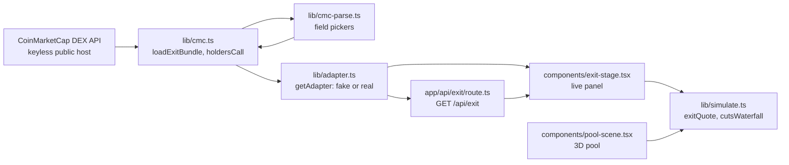

# Efflux

**Efflux shows what selling a small DEX token pays today, and what is left after the biggest wallets sell first.** A wallet shows price times balance; Efflux reads the real pools and holders from the CoinMarketCap DEX API so a holder knows how much of that number they can actually take out before pressing sell.

Live demo: https://efflux-eight.vercel.app (start on `/` and drag "Wallets selling ahead of you" from 0 to the end; this is DEMO.md step 4).

Real call, written by `npm run proof` (`scripts/proof.mjs`), never by hand:

<!-- PROOF:BEGIN holders-sample -->
Not run in this build: CoinMarketCap returned 400 (POST /v1/dex/holders/list, body `{"address":"0x532f27101965dd16442E59d40670FaF5eBB142E4","platform":"base"}`), reason: "Parameter error".
<!-- PROOF:END holders-sample -->

Which data the deployed page runs on is stated by the page itself: the note under the hero reads "Live from CoinMarketCap, BRETT on Base, fetched HH:MM UTC" in live mode, and names the seed or bundled snapshot otherwise.

## Try it in 60 seconds

1. Open https://efflux-eight.vercel.app. The 3D pool under the headline is the token's liquidity; the ink blocks are its largest holders, the magenta block is you.
2. Scroll to "The quote": the panel shows "Wallet shows $5,000" and "A sale pays you".
3. Keep scrolling to "The queue" and drag "Wallets selling ahead of you" to the end. The payout falls, the pool drains and its sold holder blocks flatten, and the camera drops to look along the holder line.
4. Press "Simulate your own exit with these controls" to open `/play`, then press **Show the CoinMarketCap calls** to see every request with its response.

Under the headline the source note says which data you are looking at, and on live data when it was fetched, in the same words the UI uses: "Live from CoinMarketCap", "Seed data, not a live response" or "Bundled snapshot, CoinMarketCap was unavailable for some tokens".

## The problem

People holding small tokens on Base, BNB Chain and Solana see a "value" in their wallet. That number is price times balance. It says nothing about how much money is actually sitting in the pools.

Here is a real token instead of a made-up pool. The figures below are computed by `exitQuote()` over live CoinMarketCap data each time `npm run proof` runs:

<!-- PROOF:BEGIN brett-exit -->
BRETT on Base, fetched 2026-11-24 11:48 UTC by `npm run proof`: wallet shows $5,000, a sale pays $4,953 now. Selling now keeps 99% of what your wallet shows.

Computed by `exitQuote()` in `lib/simulate.ts` with the sell tax on (0.0%) and LP drain off, over 20 live pools. The holder queue is not shown in this build: CoinMarketCap returned 400 (POST /v1/dex/holders/list, body `{"address":"0x532f27101965dd16442E59d40670FaF5eBB142E4","platform":"base"}`), reason: "Parameter error".
<!-- PROOF:END brett-exit -->

Read 0 as today and 10 as the worst case; the queue slider is a stress test, not a forecast.

Swap interfaces quote one trade at one moment. None of the ones we tried shows the queue.

## The solution

Paste a token, enter what your wallet shows, and Efflux tells you:

- what a sale pays right now, and the gap to the wallet number
- how much of that gap is price impact, sell tax and LP drain
- what is left after the largest holders sell ahead of you, with a slider from 0 to 10 wallets

How the number is built (all in `lib/simulate.ts`, pure functions, no I/O):

1. Every pool from `/v1/dex/token/pools` becomes a virtual constant product pool. CMC gives `liqUsd` for both sides together, so each side is half: `y = liqUsd / 2` dollars and `x = y / price` tokens.
2. A sale is split across pools in proportion to their token reserve. The deepest pool takes the biggest slice and all pools end at the same price.
3. The holder list from `POST /v1/dex/holders/list` is cleaned (pool addresses, burn, exchange, bridge and locker wallets never sell), sorted by balance, and the top N sell one after another. Reserves update after every sale. Your order goes last.
4. Sell tax from `/v1/dex/security/detail` is taken off every seller's tokens. The "repeat tomorrow" switch shrinks every pool by the share of liquidity that left in the last 24 hours, read from `/v1/dex/liquidity-change/list`.

The four losses are computed as successive scenarios, so impact + tax + drain + queue adds up exactly to "wallet shows" minus "you receive".

Concentrated liquidity pools (Uniswap v3, Raydium CLMM, Meteora DLMM, Orca) are modeled as constant product too. That understates their depth near the price, so the loss leans high for them, and the UI says so.

Run the checks with `npm test`.
`tests/simulate.test.ts` pins `exitQuote()` output for the three seed tokens at 0, 5 and 10 wallets ahead, checks that the payout never rises as more wallets sell first, that impact + tax + drain + queue equals the gap, that the rounded waterfall cuts add up to the printed gap, that "repeat tomorrow" lowers the payout when the LP shrank, and that a sale never pays more than the wallet shows.

## How the pieces fit



`components/story-scroll.tsx` holds one state object (wallets ahead, sell tax, LP drain) that feeds both the panel and the pool, so the 3D pool on `/` follows the slider and the camera follows the chapter.

## Prizes

There are no sponsor bounties in this hackathon. The three rows are placements in one judged ranking:

| Bounty | Prize | Slots | Required tech | Code file | DEMO step |
| --- | --- | --- | --- | --- | --- |
| Top 3 | Full year of CMC API access: Professional, Growth, and Startup (Top 3) | 3 | CoinMarketCap API | `lib/cmc.ts` (calls via `loadExitBundle`; parsers in `lib/cmc-parse.ts`) | 2, 4, 6 |
| Top 10 | Exclusive CMC Plushie (Top 10) | 10 | CoinMarketCap API | `lib/cmc.ts` (calls via `loadExitBundle`; parsers in `lib/cmc-parse.ts`) | 2, 4, 6 |
| Top 30 | Exclusive CMC Keyboard (Top 30) | 30 | CoinMarketCap API | `lib/cmc.ts` (calls via `loadExitBundle`; parsers in `lib/cmc-parse.ts`) | 2, 4, 6 |

A single submission is placed once, and its rank decides which prize it gets.

**How deep the integration goes.** `lib/adapter.ts` imports `loadExitBundle` from `lib/cmc.ts` and is the only data seam for every page and route. Delete `lib/cmc.ts` and, in real mode (`ADAPTER_MODE=real`), DEMO.md steps 2, 4 and 6 break: the pools behind "A sale pays you", the holder queue behind the slider and every entry in the proof drawer come from it. In fake mode the demo still runs on seed tokens, and step 6 labels its drawer entries as seed data rather than live calls.

## Addresses

| What | Address |
| --- | --- |
| Live app | https://efflux-eight.vercel.app |

Efflux deploys no contract and holds no funds (see `SECURITY.md`).

## How it uses the CoinMarketCap API

Every call runs server-side in `lib/cmc.ts`, behind the route `GET /api/exit?platform=base&address=0x...`. By default it uses the **keyless public API**, so the deployed site works on live data with no key in the repo or in Vercel. A user lookup gets 4 seconds (`LOOKUP_BUDGET_MS` in `lib/config.ts`); a slower answer returns `upstream_timeout` with a "Try again" button, and the retry is usually served from the 60 s cache.

5 DEX endpoints live: the first five rows are exactly the calls `loadExitBundle` and `holdersCall` in `lib/cmc.ts` make for every token. The last row is a wrapper (`searchTokens`) that the live UI does not call. `/notes` renders the same split from `CMC_ENDPOINTS`.

| Method | Endpoint | What Efflux takes from it |
| --- | --- | --- |
| GET | `/public-api/v1/dex/token` | price, symbol, name, supply |
| GET | `/public-api/v1/dex/token/pools` | every pool, `liqUsd`, both token sides, DEX name (virtual reserves) |
| POST | `/public-api/v1/dex/holders/list` | largest holders, balances, tags (the queue) |
| GET | `/public-api/v1/dex/security/detail` | sell tax |
| GET | `/public-api/v1/dex/liquidity-change/list` | liquidity history, for the 24h LP change |
| GET | `/public-api/v1/dex/search` | not live: wrapper exists in lib/cmc.ts, not called by the live UI yet |

### A real call, code and response

This is the holders request exactly as `lib/cmc.ts` sends it on the keyless path:

```ts
const res = await fetch("https://pro-api.coinmarketcap.com/public-api/v1/dex/holders/list", {
  method: "POST",
  headers: { Accept: "application/json", "Content-Type": "application/json" },
  body: JSON.stringify({ tokenAddress, platform: "base" }),
});
```

If CoinMarketCap answers this body with 400, `holdersCall` tries once more with the field named `address` (the name every DEX GET call uses) and keeps whichever body worked. A failed proof line quotes the body sent and CoinMarketCap's own reason.

Known open issue (2026-11-24): the keyless host answers both bodies with 400 and the reason "Parameter error", and `GET /v1/dex/security/detail` with the same `platform` and `address` query that works for `token/pools` gets 400 too. The correct request shape for these two endpoints is not settled yet. Until it is, the app quotes from live price and pools, and the queue and sell tax steps stay at zero with a one-line note saying why.

Every request is recorded with method, URL, body, status, latency and the first 2,400 characters of the raw response. On `/play`, load any token address and press **Show the CoinMarketCap calls** to see them.

#### Captured by `npm run proof`

`scripts/proof.mjs` makes real keyless calls for the demo tokens (or keyed calls when `CMC_PRO_API_KEY` is set) and rewrites the two blocks below, plus the timing table under "Measured latency". The keyless limit is per IP, so a 429 is retried up to 4 times, after the Retry-After wait CoinMarketCap sends or a growing backoff. When CoinMarketCap still cannot be reached, it says so in one line instead of showing a response.

<!-- PROOF:BEGIN cmc-call -->
Captured by `npm run proof` at 2026-11-24T11:48:02.081Z, keyless host, no key header sent. First 600 characters of each response.

**GET /public-api/v1/dex/token/pools (base, `0x532f27101965dd16442E59d40670FaF5eBB142E4`)**: status 200, 440 ms

```json
{"data":[{"addr":"0xba3f945812a83471d709bce9c3ca699a19fb46f7","v24":"1578.258126715657339424","pubAt":"1709041137000","t0":{"addr":"0x4200000000000000000000000000000000000006","lg":"https://s2.coinmarketcap.com/static/img/coins/64x64/2396.png","n":"Wrapped Ether","sym":"WETH","liq":"300.767214370237889634","liqUsd":"505840.576686368379921758"},"t1":{"addr":"0x532f27101965dd16442e59d40670faf5ebb142e4","lg":"https://s2.coinmarketcap.com/static/img/coins/64x64/29743.png","n":"Brett","sym":"BRETT","liq":"87546197.04095436187853372","liqUsd":"269351.28612489284051083"},"bidx":1,"exid":7791,"exn":"U
```

**GET /public-api/v1/dex/token/pools (solana, `DezXAZ8z7PnrnRJjz3wXBoRgixCa6xjnB7YaB1pPB263`)**: status 200, 350 ms

```json
{"data":[{"addr":"5zpyutJu9ee6jFymDGoK7F6S5Kczqtc9FomP3ueKuyA9","v24":"252588.510109342372698559","pubAt":"1726946017000","t0":{"addr":"DezXAZ8z7PnrnRJjz3wXBoRgixCa6xjnB7YaB1pPB263","lg":"https://s2.coinmarketcap.com/static/img/coins/64x64/23095.png","n":"Bonk","sym":"Bonk","liq":"69314075658.18673","liqUsd":"149890.786515698416786505"},"t1":{"addr":"So11111111111111111111111111111111111111112","lg":"https://dex-static.sintral.io/token-logo/16/So11111111111111111111111111111111111111112/1766048405124.jpeg","n":"Wrapped SOL","sym":"wSOL","liq":"894.456641846","liqUsd":"63071.788678053048910367"
```

- Not run in this build: CoinMarketCap returned 400 (POST /v1/dex/holders/list, body `{"address":"0x532f27101965dd16442E59d40670FaF5eBB142E4","platform":"base"}`), reason: "Parameter error".
<!-- PROOF:END cmc-call -->

Field names seen in those responses, checked against the parser candidates:

<!-- PROOF:BEGIN cmc-fields -->
Keys seen in the real responses, checked against the candidate keys in `lib/cmc-parse.ts`.

- GET /public-api/v1/dex/token/pools (base, `0x532f27101965dd16442E59d40670FaF5eBB142E4`): top-level keys `data, status`; first item keys `addr, v24, pubAt, t0, t1, bidx, exid, exn, liqUsd, fa, top, mi`
  - liquidity: found `liqUsd`
  - address: found `addr`
  - dex: found `exn`
  - version: none of `v, version, poolType, type`
  - fee: none of `feeRate, fee`
  - sides: found `t0, t1`
- GET /public-api/v1/dex/token/pools (solana, `DezXAZ8z7PnrnRJjz3wXBoRgixCa6xjnB7YaB1pPB263`): top-level keys `data, status`; first item keys `addr, v24, pubAt, t0, t1, bidx, exid, exn, liqUsd, fa, top, mi`
  - liquidity: found `liqUsd`
  - address: found `addr`
  - dex: found `exn`
  - version: none of `v, version, poolType, type`
  - fee: none of `feeRate, fee`
  - sides: found `t0, t1`
- Not run in this build: CoinMarketCap returned 400 (POST /v1/dex/holders/list, body `{"address":"0x532f27101965dd16442E59d40670FaF5eBB142E4","platform":"base"}`), reason: "Parameter error".
<!-- PROOF:END cmc-fields -->

### Measured latency

The demo has a 5 second rule per step. `npm run proof` times the five calls the app makes for each demo token and rewrites the table below. In the app itself, the sample list gives each demo token 4 seconds (`LIST_BUDGET_MS` in `lib/config.ts`); a token that misses it is served from its seed snapshot and named in the source note.

<!-- PROOF:BEGIN demo-timing -->
Measured by `npm run proof` at 2026-11-24T11:48:02.081Z, keyless host. Each row runs the five calls the app makes for one token, in parallel, timed with `performance.now()`.

| Token | Chain | Total ms | Status codes (token, pools, holders, security, liquidity) | Within 5 s |
| --- | --- | --- | --- | --- |
| BRETT | base | 1307 | 200, 200, 400, 400, 200 | yes |
| Bonk | solana | 885 | 200, 200, 400, 400, 200 | yes |
<!-- PROOF:END demo-timing -->

### What the API made possible and where it pushed back

- **Made possible: a zero-secret deploy.** The keyless public endpoints serve price, pools and liquidity history for Base, BNB Chain and Solana with no key (holders and sell tax live on the same host, but our request shape for them still gets 400, see above), so the judged link runs on live data with nothing secret in the repo or in Vercel, and keeps working after the hackathon tier expires.
- **Pushed back: no reserve field.** Pools carry `liqUsd` for both sides together but no raw reserves, so Efflux builds virtual reserves: `liqUsd / 2` dollars per side and `(liqUsd / 2) / price` tokens.
- **Pushed back: an undocumented unit.** The holders `percent` field does not say whether 0.05 means 5% or 0.05%. Efflux ignores it and computes share of supply from `actualBalance` and the token supply. Short fields such as `a0`, `a1` and `tu` in the liquidity change list are not described either.
- **Pushed back: shared rate limits.** Keyless limits are per IP, and serverless functions share IPs, so 429s happen. Every GET is cached 60 seconds and the holders POST is memoized for the same 60 seconds. Every call is aborted after 8 seconds, and a 429, a network error or a timeout gets exactly one retry after 600 ms.

Optional: set `CMC_PRO_API_KEY` in Vercel and the same paths go to the keyed host. The key travels as a header and never appears in the proof drawer or the logs.

## Tech stack

Exactly what `package.json` installs:

- Next.js 15 (App Router), React 19, TypeScript 5 (strict), Tailwind CSS 4
- three 0.187 with `@react-three/fiber` 9 and `@react-three/drei` 10 for the interactive pool on the home page
- Zod 3 for input validation on every API route (`lib/schemas.ts`)
- Vitest 3 for the tests
- CoinMarketCap DEX API, keyless public endpoints, through a Route Handler proxy with a 60 s cache. Every call is aborted after 8 seconds, and a 429, a network error or a timeout gets exactly one retry after 600 ms.
- Deployed on Vercel

## Quickstart

```bash
git clone https://github.com/mericcintosun/efflux
cd efflux
npm install
npm run dev
```

Then open http://localhost:3000. No environment variables are required. `.env.example` lists every key; `lib/config.ts` is the only file that reads them (plus `ADAPTER_MODE` in `lib/adapter.ts`).

### Data modes

Pages and API routes read tokens through one adapter (`lib/adapter.ts`). With `ADAPTER_MODE=fake`, the default, they serve the seed tokens in `lib/data/seed.ts` and make no network calls, and the source note reads "Seed data, not a live response". With `ADAPTER_MODE=real`, the demo tokens (BRETT on Base and BONK on Solana by default, overridable with `EFFLUX_DEMO_*_ADDRESS`) and every pasted address load live from the CoinMarketCap DEX API through `lib/cmc.ts`, and the note reads "Live from CoinMarketCap". A demo token that fails to load falls back to its seed token, and the note reads "Bundled snapshot, CoinMarketCap was unavailable for some tokens". `npm run seed` writes the seed tokens to `fixtures/seed.json`, and two runs give the same file.

### Reset the demo

```bash
npm run demo:reset
```

It removes `.next/cache/fetch-cache` (the 60 s CoinMarketCap response cache) if it exists and regenerates `fixtures/seed.json` exactly as `npm run seed` does, then prints one line saying what it reset. Efflux stores nothing on the server: the share link carries every control in the URL, so there is no database and no migration to run. Restarting the server also clears the in-memory 60 s holders cache.

API errors come back as `{ "error": "<code>", "hint": "<sentence>" }` with codes from `lib/errors.ts` (`invalid_input` 400, `not_found` 404, `parse_failure` 422, `upstream_error` 502, `upstream_timeout` 504).

### Tests

```bash
npm test        # vitest: exit math snapshot, cuts waterfall sums, CMC parsers, input schemas
npm run proof   # real keyless CoinMarketCap calls, written into the proof blocks above
```

The parser fixtures in `fixtures/cmc/` are hand-written to the OpenAPI field names, not captured responses; each one says so in its `_note` key.

Routes:

- `/` the story: four chapters drive one live component (the 3D pool and the exit panel), from a clean quote to the whale queue
- `/play` the simulator: sample tokens, paste any address, the hidden cuts as a waterfall, share a link to the result
- `/notes` method, endpoint list, a real call and the API notes

Security notes are in `SECURITY.md` (no contract, no wallet, no stored data). The submission checklist is `DELIVERY.md`; the form fields are in `SUBMISSION.md`.

## What we would build next

- A real concentrated liquidity model for v3 and CLMM pools using tick data
- Vitest cases for `lib/simulate.ts` against known Uniswap v2 swaps (today the tests pin our own output)
- An alert when the queue ahead of a position gets thinner than a set dollar amount

Not wired yet: `searchTokens()` in `lib/cmc.ts` wraps `/v1/dex/search`, but no page or route calls it, so today you paste an address.

## AI use

The hackathon rules say: "open-source dependencies and AI coding assistants are allowed, no declaration required" (Turkish source: açık kaynak bağımlılıklar ve AI kodlama asistanları serbest, beyan etmeye de gerek yok). We say it anyway: an AI coding assistant was used to write and review parts of this code and these docs. Product decisions and the final review are ours.

Efflux shows estimates, not financial advice.
